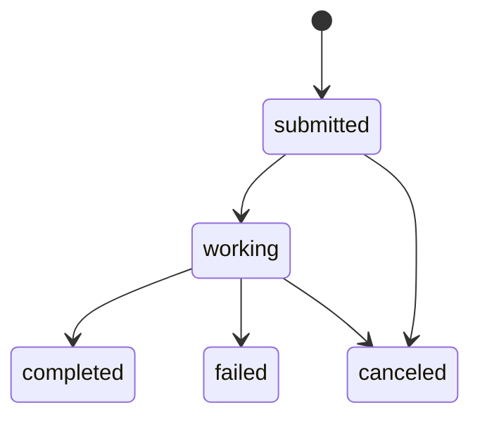

# nanobot A2A MVP Protocol Contract

## 1) Contract status

- Purpose: lock protocol behavior for nanobot A2A MVP implementation.
- Contract scope: server-side A2A surface only.
- Target spec: A2A Protocol `0.3` (latest stable at lock time).
- Binding: `HTTP+JSON` only.
- Authentication: Bearer token (`Authorization: Bearer <token>`).

## 2) Protocol lock

### Version and binding

- Protocol version is fixed to `0.3` for MVP.
- Transport/binding is fixed to `HTTP+JSON`; JSON-RPC transport is not used for MVP.
- All payloads are JSON objects.

### Method namespace (MVP)

Exact method names are fixed and must not drift:

- `send`
- `get`
- `list`
- `cancel`

HTTP+JSON endpoint mapping for MVP:

- `send` -> `POST /a2a/tasks:send`
- `get` -> `GET /a2a/tasks/{task_id}`
- `list` -> `GET /a2a/tasks`
- `cancel` -> `POST /a2a/tasks/{task_id}:cancel`

## 3) Common schema

### Task states

Allowed states:

- `submitted`
- `working`
- `completed`
- `failed`
- `canceled`

Task envelope (shared across responses):

```json
{
  "task": {
    "id": "task_123",
    "state": "submitted",
    "created_at": "2026-02-11T00:00:00Z",
    "updated_at": "2026-02-11T00:00:00Z",
    "metadata": {}
  }
}
```

### Error envelope

All non-2xx responses return:

```json
{
  "error": {
    "code": "invalid_params",
    "jsonrpc_code": -32602,
    "http_status": 400,
    "message": "Invalid request payload",
    "details": {}
  }
}
```

- `code`: stable string identifier.
- `jsonrpc_code`: compatibility mapping to JSON-RPC code space.
- `http_status`: actual HTTP status returned.

## 4) Method contracts

### `send`

Create a task from a text request.

Request (`POST /a2a/tasks:send`):

```json
{
  "method": "send",
  "input": {
    "messages": [
      {
        "role": "user",
        "content": "Summarize this changelog.",
        "content_type": "text/plain"
      }
    ]
  },
  "options": {
    "wait": false,
    "timeout_ms": 30000
  },
  "metadata": {}
}
```

Response:

- `202 Accepted` when queued/started asynchronously.
- `200 OK` when `wait=true` and task reaches terminal state before timeout.

```json
{
  "task": {
    "id": "task_123",
    "state": "submitted",
    "created_at": "2026-02-11T00:00:00Z",
    "updated_at": "2026-02-11T00:00:00Z",
    "metadata": {}
  },
  "output": null
}
```

### `get`

Get task status and final output/error when available.

Request (`GET /a2a/tasks/{task_id}`):

- Path param: `task_id` (required)

Response (`200 OK`):

```json
{
  "task": {
    "id": "task_123",
    "state": "completed",
    "created_at": "2026-02-11T00:00:00Z",
    "updated_at": "2026-02-11T00:00:03Z",
    "metadata": {}
  },
  "output": {
    "messages": [
      {
        "role": "assistant",
        "content": "Here is the summary...",
        "content_type": "text/plain"
      }
    ]
  },
  "failure": null
}
```

### `list`

List tasks with simple cursor pagination.

Request (`GET /a2a/tasks`):

- Query params:
  - `state` (optional, one of task states)
  - `limit` (optional, default `20`, max `100`)
  - `cursor` (optional)

Response (`200 OK`):

```json
{
  "tasks": [
    {
      "id": "task_123",
      "state": "working",
      "created_at": "2026-02-11T00:00:00Z",
      "updated_at": "2026-02-11T00:00:01Z",
      "metadata": {}
    }
  ],
  "next_cursor": null
}
```

### `cancel`

Request cancellation of an in-flight task.

Request (`POST /a2a/tasks/{task_id}:cancel`):

```json
{
  "method": "cancel",
  "reason": "User requested cancellation"
}
```

Response (`200 OK`):

```json
{
  "task": {
    "id": "task_123",
    "state": "canceled",
    "created_at": "2026-02-11T00:00:00Z",
    "updated_at": "2026-02-11T00:00:02Z",
    "metadata": {}
  }
}
```

If already terminal, server returns current terminal state without reopening the task.

## 5) Error mapping

### JSON-RPC compatibility codes

| HTTP | `jsonrpc_code` | `code` | Meaning |
|---|---:|---|---|
| 400 | -32700 | `parse_error` | Malformed JSON |
| 400 | -32600 | `invalid_request` | Invalid envelope or top-level shape |
| 404 | -32601 | `method_not_found` | Unknown A2A method/route |
| 400 | -32602 | `invalid_params` | Schema/type/field validation failed |
| 500 | -32603 | `internal_error` | Unhandled server failure |

### A2A-specific errors

| HTTP | `jsonrpc_code` | `code` | Trigger |
|---|---:|---|---|
| 401 | -32001 | `auth_required` | Missing bearer token when auth enabled |
| 401 | -32002 | `auth_invalid` | Invalid bearer token |
| 403 | -32003 | `forbidden` | Caller blocked by policy/allowlist |
| 404 | -32004 | `task_not_found` | `task_id` does not exist |
| 409 | -32005 | `task_not_cancelable` | Cancellation requested after terminal state |
| 415 | -32006 | `unsupported_type` | Non-text payload or unsupported `content_type` |
| 429 | -32007 | `rate_limited` | Request/rate limits exceeded |
| 504 | -32008 | `upstream_timeout` | Worker timeout reached |

## 6) Task lifecycle and transitions

State diagram:



Transition rules:

- Initial state is always `submitted`.
- `submitted -> working` when execution starts.
- `submitted -> canceled` if canceled before execution begins.
- `working -> completed` on success.
- `working -> failed` on execution error.
- `working -> canceled` on accepted cancellation.
- Terminal states (`completed`, `failed`, `canceled`) are immutable.

## 7) Text-only payload policy

MVP accepts text content only.

- Allowed `content_type`: `text/plain`, `text/markdown`.
- Required `content`: string.
- Rejected content includes binary/file/image/audio/video/object payloads.

Unsupported type behavior:

- HTTP status: `415`.
- Error code: `unsupported_type`.
- JSON-RPC mapping: `-32006` (A2A-specific) and treated as invalid params class.

Example error:

```json
{
  "error": {
    "code": "unsupported_type",
    "jsonrpc_code": -32006,
    "http_status": 415,
    "message": "MVP supports text/plain and text/markdown only",
    "details": {
      "received_content_type": "image/png"
    }
  }
}
```

## 8) Explicitly out of scope (MVP)

The following are intentionally excluded from MVP and must not be implemented or advertised:

- Streaming responses/events.
- Push notifications / callback delivery.
- A2A client mode / federation to other agents.
- Multimodal payloads (file/image/audio/video).
- WebSocket or gRPC protocol bindings.
- JSON-RPC transport endpoint.

## 9) Guardrails for follow-up tasks

- Future tasks (2-8) must conform to this file as the source-of-truth contract.
- Any protocol-surface change requires explicit contract update first.
- Implementation details may evolve; method names, states, error codes, and scope boundaries above are locked for MVP.
